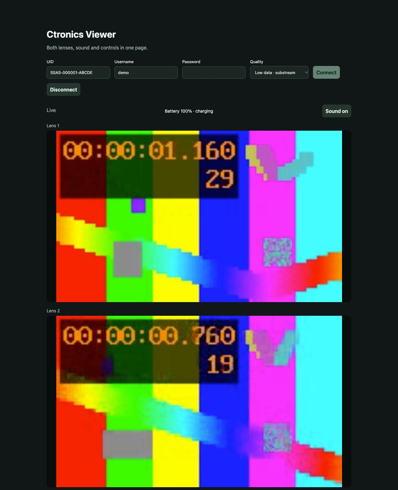

   # Ctronics Viewer

An unofficial local browser viewer for dual-lens Ctronics/HiChip 4G cameras in the SSAS family.

- Two live players, stacked vertically.
- Camera audio with a separate sound toggle.
- Battery percentage outside the video, refreshed about every 30 seconds.
- Pan/tilt buttons with hold-to-move and explicit stop.
- Low-data and main-stream quality options.

One Python process connects the camera to your browser. No additional hosted account, database, container or deployed application is needed. Camera discovery and relay still use the official HiChip P2P infrastructure.

The preview uses generated test feeds and demonstration credentials. PTZ controls sit below the players.

## Quick start

Install [Python 3.11 or newer](https://www.python.org/downloads/) and [FFmpeg](https://ffmpeg.org/download.html), then make sure ffmpeg is available on PATH. FFmpeg needs the libx264 encoder for H.265 cameras. Use a current browser with MediaSource and Web Audio support.

Download or clone this repository, open a terminal in its folder, and run:

    python3 start.py

On Windows:

    py start.py

The launcher creates a local .venv and installs the pinned dependency from requirements.txt on first use. Internet access is required for that first installation. Later starts reuse the environment. Some Linux distributions require the Python venv package to be installed separately.

Enter your camera's UID, username and password, then click **Connect**. The password field is cleared after submission. If the browser does not open automatically, use the local address printed in the terminal.

## Controls

**Low data** selects the substreams. **Main stream** requests higher detail. Quality changes apply on the next connection. Playback starts after buffering roughly two seconds of video.

Sound starts when you connect. If the browser blocks playback, click **Enable sound**. Use the separate sound button in the page; the two video elements carry video only.

Hold an arrow to move the camera. Releasing it stops movement. The center square sends an explicit stop. Keyboard users can focus an arrow with Tab and hold Space or Enter. Repeated finite steps and a backend timeout limit motion if the page disappears.

**Disconnect**, closing the page, or Ctrl+C in the terminal ends the session.

## How it works

    Camera <-- HiChip UDP/P2P --> Python + FFmpeg <-- local HTTP --> Browser
                                      |                         two video players
                                credentials in memory           Web Audio
                                                                battery + PTZ

The server binds only to 127.0.0.1 on a random port. Each run generates a temporary URL and request token; requests also require the expected Host and Origin. Credentials are held in memory and are not written to application logs or files.

H.264 video is remuxed without re-encoding. H.265 is converted locally to H.264. G.711 A-law audio is decoded to 8 kHz mono PCM and scheduled against the first video's playback clock. The browser uses native APIs; there is no frontend build step.

Live viewing uses the camera's mobile data. This implementation preserves the vendor protocol and its security properties; it does not add end-to-end encryption to HiChip P2P.

## Compatibility and validation

Hardware validation covered one SSAS 4G-LC dual-lens camera in the 600000-899999 serial range on macOS: two 640x360 streams at 15 FPS, battery updates, incoming audio and horizontal PTZ. A test of more than 12 minutes kept both players advancing at wall-clock speed, about 4 ms apart, with roughly 1.5-2 seconds buffered.

Windows and Linux hardware, other camera families, main-stream quality and audible output at the user's speakers have not been verified. Audio reception, decoding and Web Audio scheduling were checked. Firmware variations may require protocol changes.

Video timing is calibrated once at connection and assumes a fixed frame rate. Reconnect if the camera changes its frame rate or a prolonged 4G interruption disrupts playback. Battery and charging indicators reflect the values reported by the camera.

## Tests

After the first launch:

    .venv/bin/python -m unittest discover -v
    node test_frontend.cjs

Windows:

    .venv\Scripts\python.exe -m unittest discover -v
    node test_frontend.cjs

Node.js 22 or newer is needed only for frontend tests. FFmpeg and ffprobe, with libx264 and libx265, are needed for synthetic media tests. Tests use fake cameras, local media and loopback HTTP; no real camera or credentials are needed.

The GitHub Actions workflow runs the same tests on Ubuntu with Python 3.11 and 3.13 and Node.js 24.

## Contributing

See [CONTRIBUTING.md](CONTRIBUTING.md) for development and bug reports.

This project is independent of Ctronics and HiChip. Their names identify compatible devices and software.

## License and intended use

[MIT](LICENSE), including its warranty disclaimer and limitation of liability. See [THIRD_PARTY.md](THIRD_PARTY.md) for required notices. Python, FFmpeg and PyCryptodome are installed separately and are not bundled.

Use this software only with cameras and accounts you own or are authorized to access.
